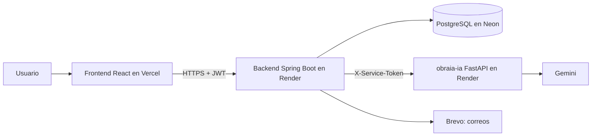

# obraia-frontend


Interfaz web de **ObraIA**, plataforma con inteligencia artificial para planear, presupuestar y hacer seguimiento a obras pequeñas.
Proyecto final de Patrones de Software: Kevin Basante y Arley Riascos.

El frontend solo se comunica con el backend (`obraia-backend`). Nunca accede a la base de datos ni al servicio de IA, y no guarda ninguna clave.

## Arquitectura



Dentro del frontend, cada capa solo llama a la siguiente:

| Capa        | Carpeta                 | Qué hace                                             |
| ----------- | ----------------------- | ---------------------------------------------------- |
| Páginas     | `pages/`, `layouts/`    | Arman cada pantalla y deciden qué mostrar            |
| Componentes | `components/`           | Piezas visuales reutilizables                        |
| Hooks       | `hooks/`, `context/`    | Sesión, carga de datos y envío de formularios        |
| Servicios   | `services/`             | Una función por ruta del backend                     |
| Cliente     | `services/apiClient.js` | `fetch`, errores con la forma del backend y tokens   |

## Tecnologías

- React 19
- Vite
- React Router 7 (navegación entre páginas)
- Vitest (pruebas)
- Fuentes Archivo, Manrope e IBM Plex Mono, instaladas con npm (`@fontsource`), sin depender de Google Fonts
- Oxlint para revisar el código

## Requisitos

- Node.js 22.12 o superior (lo pide Vitest)
- Git
- El backend corriendo (en local o en Render)

## Instalación

```bash
git clone https://github.com/Kevin-Basante/obraia-frontend.git
cd obraia-frontend
npm install
```

## Variables de entorno

1. Copia `.env.example` y renómbralo a `.env`.
2. Por defecto apunta al backend local (`http://localhost:8080`).

| Variable       | Descripción                                                                     |
| -------------- | ------------------------------------------------------------------------------- |
| `VITE_API_URL` | URL del backend, sin barra al final. Ejemplo: `https://obraia-backend.onrender.com` |

Esta variable solo guarda la URL pública del backend. Las claves (base de datos, IA) nunca van en el frontend.

## Comandos

| Comando           | Qué hace                                                  |
| ----------------- | --------------------------------------------------------- |
| `npm run dev`     | Inicia el servidor de desarrollo en <http://localhost:5173> |
| `npm run build`   | Genera la versión de producción en `dist/`                |
| `npm run preview` | Muestra localmente la versión de producción               |
| `npm run lint`    | Revisa el código con Oxlint                               |
| `npm test`        | Ejecuta las pruebas con Vitest                            |
| `npm run coverage` | Pruebas con el reporte de cobertura (`coverage/index.html`) |

## Páginas

| Ruta               | Página                                                         | Acceso                  |
| ------------------ | -------------------------------------------------------------- | ----------------------- |
| `/`                | Inicio: qué hace ObraIA, cómo funciona y las fases de una obra | Todos                   |
| `/register`        | Crear cuenta                                                   | Sin sesión              |
| `/check-email`     | Aviso de correo enviado y botón para reenviarlo                | Todos                   |
| `/verify-email`    | Confirma el correo con el enlace recibido (`?token=`)          | Todos                   |
| `/login`           | Iniciar sesión o entrar como invitado                          | Sin sesión              |
| `/forgot-password` | Pedir el enlace para cambiar la contraseña                     | Sin sesión              |
| `/reset-password`  | Elegir una contraseña nueva con el enlace recibido (`?token=`) | Todos                   |
| `/dashboard`       | Panel del usuario: totales de todas sus obras y una tarjeta por obra con avance, gasto y riesgo | Con sesión o invitado |
| `/catalog/materials` | Materiales con precio de referencia, filtro por categoría y búsqueda | Todos           |
| `/catalog/project-types` | Tipos de obra                                              | Todos                   |
| `/catalog/project-types/:id` | Fases estándar según el tamaño o el área, y materiales por elemento | Todos      |
| `/catalog/cities`  | Ciudades con su % de transporte, filtro por departamento y búsqueda | Todos              |
| `/projects`        | Mis obras, con filtro por estado y búsqueda por nombre o ciudad | Con cuenta             |
| `/projects/new`    | Crear una obra                                                 | Con cuenta              |
| `/projects/:id`    | Dashboard de la obra: indicadores, fases, próximas tareas, dinero, riesgo, maestro de obra y miembros | Con cuenta (miembros) |
| `/projects/:id/edit` | Editar una obra que no esté terminada ni cancelada           | Con cuenta (miembros)   |
| `/projects/:id/delete` | Advertencias y envío del correo para eliminar la obra      | Con cuenta (creador)    |
| `/projects/:id/blueprints` | Planos de la obra: subir fotos o PDF y borrarlos        | Con cuenta (miembros)   |
| `/projects/:id/blueprints/:blueprintId` | Ver un plano dentro de la página y descargarlo | Con cuenta (miembros) |
| `/projects/:id/measurements` | Medidas manuales: agregar, editar, borrar y filtrar por piso | Con cuenta (miembros) |
| `/projects/:id/measurements/comparison` | Totales manuales contra los de la IA       | Con cuenta (miembros)   |
| `/projects/:id/phases` | Plan de trabajo: crear las fases, tareas, estados y avance | Con cuenta (miembros)   |
| `/projects/:id/tasks/:taskId` | Avance de una tarea: reportar y ver los reportes       | Con cuenta (miembros)   |
| `/projects/:id/budgets` | Cotización actual de la obra y versiones guardadas del presupuesto | Con cuenta (miembros) |
| `/projects/:id/budgets/:budgetId` | Una versión del presupuesto con sus capas de costo y el botón para aprobarla | Con cuenta (miembros) |
| `/projects/:id/materials` | Materiales a comprar según la última versión guardada | Con cuenta (miembros)   |
| `/projects/:id/expenses` | Gastos de la obra: registrar, borrar y comparar con el presupuesto aprobado | Con cuenta (miembros) |
| `/notifications`   | Mis notificaciones: abrirlas y marcarlas como leídas           | Con cuenta              |
| `/site-managers`   | Mis maestros de obra: agregar, editar y borrar                 | Con cuenta              |
| `/account`         | Mi cuenta: editar el perfil, cambiar la contraseña y el enlace para eliminarla | Con cuenta |
| `/account/delete`  | Advertencias, contraseña y envío del correo para eliminar la cuenta | Con cuenta         |
| `/confirm-deletion` | Confirma la eliminación con el enlace recibido (`?token=`)    | Todos                   |
| `/confirm-account-deletion` | Confirma la eliminación de la cuenta con el enlace recibido (`?token=`) | Todos |

Una ruta desconocida muestra "Page not found". Un invitado que abre una página de obras ve una invitación a crear su cuenta, porque las obras se guardan en la cuenta. Si alguien sin sesión abre `/dashboard`, se le envía a `/login` y, al entrar, vuelve a la página que pidió.

## Diseño

- **Estilo de obra:** la interfaz parece una hoja de planos. Fondo de papel de dibujo, tonos de concreto y arena, rojo ladrillo para las acciones y franjas de seguridad amarillas y negras.
- **Colores:** todos salen de las variables de `src/index.css`, con un tema claro y uno oscuro. Ningún otro archivo CSS escribe colores directamente.
- **Letras:** Archivo (condensada) para los títulos, Manrope para el texto e IBM Plex Mono para las etiquetas técnicas, como las notas de un plano.
- **Inicio:** un plano que se dibuja solo, la IA lo mide y el presupuesto sube hasta su valor; después, cómo funciona, las ocho fases de una obra y lo que incluye.
- **Dibujos:** cada fase y cada material tiene un dibujo de línea en SVG (`components/art/`). `utils/artFor.js` elige el dibujo por el nombre que llega del backend (en español) y, si no lo reconoce, por la categoría.
- **Tema claro y oscuro:** el botón del sol o la luna, arriba a la derecha, cambia el tema. La primera vez se usa el del sistema; después se recuerda la elección en el navegador (`localStorage`). `index.html` aplica el tema antes de dibujar la página para que no parpadee.
- **Pantalla completa:** las páginas usan todo el ancho de la pantalla, sin márgenes vacíos a los lados. En pantallas anchas (desde 1280 px) los formularios de medidas y gastos quedan al lado de su tabla o resumen.
- **Idiomas (ES/EN):** el botón `ES` o `EN`, al lado del de tema, cambia todo el sitio entre español e inglés. La primera vez se usa el idioma del navegador; después se recuerda la elección (`localStorage`). Las fechas siguen el idioma; el dinero y los números siguen en formato colombiano. `index.html` le pide al traductor del navegador que no traduzca la página, porque el sitio ya tiene su propio botón.
- **Animaciones:** solo con CSS: líneas que se dibujan, secciones que suben al aparecer en pantalla (`useInView`) y barras que crecen. Si el sistema pide menos movimiento (`prefers-reduced-motion`), se muestran sin animación.

## Idiomas

- Todo el código y las claves están en inglés. Los textos de la interfaz están en `src/i18n/en.json` y `src/i18n/es.json`, con las mismas claves en los dos archivos (una prueba lo revisa).
- `t('header.catalog')` devuelve el texto en el idioma actual. Acepta valores (`t('projectList.starts', { date })`) y plural (`{ one, other }` según `count`). Si falta un texto en español, usa el inglés.
- **Datos del backend:** el backend envía códigos (`in_progress`, `wall`, `late_tasks`...) y los valores de cada frase (`params`). El frontend arma la frase en el idioma elegido: estados, categorías, elementos, reglas de riesgo y su detalle, notificaciones, filas del presupuesto, mensajes de la cuenta y errores (`errors.<CODE>`). Si llega un código que el frontend no conoce, muestra el texto que envió el backend.
- Los datos que escribe el usuario y los del catálogo (nombres de obras, fases, materiales y ciudades) se muestran tal como están guardados.
- Las evaluaciones y notificaciones de riesgo creadas antes de la versión 1.3.0 también se traducen: la migración V7 del backend les agregó sus códigos y valores.

## Dashboard

- **Dashboard general (`/dashboard`):** lee `GET /api/dashboard` y muestra el número de obras, las que están en riesgo alto o crítico, la suma de los presupuestos aprobados y lo gastado. Debajo, una tarjeta por obra con su avance, el gasto contra el presupuesto y el último riesgo.
- **Dashboard de la obra (`/projects/:id`):** lee `GET /api/dashboard/projects/{id}` y reúne en una sola página lo que antes pedía varios clics:
  - cinco indicadores: avance, presupuesto gastado, riesgo, fase actual y registros (medidas, planos y miembros);
  - las fases con su dibujo, estado, fechas y barra de avance;
  - las próximas tareas, primero las atrasadas, cada una con enlace a su avance;
  - el dinero: presupuesto aprobado, gastado, lo que queda y el gasto por categoría;
  - el riesgo, el maestro de obra y los miembros.
- Las cifras las calcula el backend; la página solo las muestra. Al cambiar el estado de la obra o evaluar el riesgo, el dashboard se vuelve a cargar.
- La cuadrícula es de 12 columnas; por debajo de 1100 px cada tarjeta ocupa todo el ancho.

## Catálogo

- Lee los catálogos públicos del backend (`/api/catalogs/...`), así que funciona con sesión, como invitado o sin sesión.
- Las búsquedas esperan a que el usuario deje de escribir (300 ms) antes de llamar al backend, para no enviar una petición por cada tecla.
- Mientras llega una respuesta nueva, la lista anterior sigue visible y atenuada; si llega una respuesta vieja, se ignora.
- Los precios se muestran en pesos colombianos (`$ 33.000`) y las cantidades con coma decimal (`12,5`).
- En el detalle de un tipo de obra, el área construida decide el tamaño: hasta 120 m² es pequeña y más de 120 m² es grande.
- Los materiales se muestran en tarjetas, cada una con el dibujo del material, y las fases del tipo de obra como un camino numerado con el dibujo de cada fase.

## Obras

- Una obra nueva empieza en borrador. La página de la obra muestra solo los cambios de estado que permite el backend (`nextStatuses`); terminar o cancelar pide confirmación, porque después la obra ya no se puede editar.
- El área acepta coma o punto decimal (`120,5`). El formulario revisa los mismos límites que el backend antes de enviarlo: nombre de 3 a 150 caracteres, área de 1 a 2000 m², 1 o 2 pisos y la fecha de fin no antes que la de inicio.
- Cada usuario guarda sus maestros de obra en `/site-managers` y los asigna desde la página de la obra.
- Cualquier miembro puede agregar a otra persona con cuenta verificada escribiendo su correo. Al creador no se le puede quitar.
- Eliminar tiene dos pasos: la página muestra lo que se va a perder y envía un correo; la obra se elimina solo cuando el creador abre el enlace (`/confirm-deletion`), que vence en 30 minutos.

## Planos y medidas

- Cada obra acepta hasta 10 planos: PDF o imagen (PNG, JPG o WEBP) de máximo 10 MB. El navegador revisa la extensión y el tamaño antes de subir; el backend revisa además el tipo real del archivo.
- El archivo se sube como `multipart/form-data` (campo `file`). Para verlo, el frontend lo descarga con el token y lo muestra desde una dirección temporal del navegador (`URL.createObjectURL`), que se libera al salir de la página.
- El formulario de medidas pide solo las dimensiones del elemento elegido, según `/api/catalogs/element-types`: largo, ancho y alto para cimentación, columnas, vigas y losas (m³); largo y alto para muros, y largo y ancho para piso y cubierta (m²). Mientras se escribe, muestra la cantidad que calculará el backend.
- Las medidas aceptan coma decimal (`3,5`) y el piso no puede ser mayor que los pisos de la obra.
- **Analyze with AI** envía el plano al backend (`POST /blueprints/{id}/analyze`), que lo pasa al servicio de IA. Mientras lee, el botón dice **Reading…** y la página avisa que la primera lectura del día puede tardar cerca de un minuto. Al terminar se ven las medidas que guardó, las que descartó y las advertencias de la IA, con un enlace a la comparación.
- La columna **AI reading** muestra el estado del plano: `Pending`, `Completed` o `Failed`. Un plano leído se puede volver a leer (**Analyze again**); si el archivo es el mismo, el backend responde desde su caché sin llamar a la IA.
- Los errores de la IA se explican en la página: servicio sin configurar (503), límite de lecturas por hora de la obra (429) o fallo de la IA (502).
- Las medidas leídas por la IA no tienen botones para editar ni borrar, y muestran cuánto se alejan del total manual de su elemento y piso. Mientras la IA no lea planos, la comparación muestra solo los totales manuales.
- En una obra terminada o cancelada, los planos y las medidas se pueden ver pero no cambiar.

## Fases y tareas

- Mientras la obra no tiene plan, la página muestra las fases que se crearían (`/phases/preview`): las del catálogo según el tipo y el tamaño de la obra. El local comercial trae además la fase "Adecuación comercial". El botón **Create plan** las guarda con sus tareas iniciales.
- Las fechas de las fases salen de la fecha de inicio planeada de la obra, contando de lunes a sábado. Si la obra no tiene fecha, el plan se crea sin fechas y se pueden poner a mano en cada fase.
- Cada fase y tarea muestra solo los botones de los cambios de estado que permite el backend (`nextStatuses`): **Start**, **Mark as delayed**, **Complete**, **Resume** o **Reopen**. Una fase o tarea que pasó su fecha de fin sin completarse aparece como **Late**.
- Las tareas se pueden agregar, editar, pasar a otra fase y borrar. El formulario revisa el nombre (3 a 150 caracteres) y que la fecha de fin no sea antes que la de inicio.
- En la página de una tarea se reporta el avance de 0 a 100 % (acepta coma decimal) con fecha opcional, que no puede ser futura. Si la obra tiene maestro de obra, se puede marcar que el reporte lo dio él. Más de 0 % inicia la tarea, 100 % la completa y la fase se completa sola cuando todas sus tareas lo están.
- El avance de una tarea es su último reporte; el de la fase y el de la obra son promedios que calcula el backend.
- El plan se puede borrar para crearlo de nuevo solo mientras ninguna tarea tenga reportes. En una obra terminada o cancelada todo se puede ver pero no cambiar.

## Presupuesto

- La página de presupuesto muestra la cotización actual (`/budgets/preview`) sin guardar nada: ciudad, % de transporte, días hábiles y una fila por cada capa de costo (materiales, desperdicio, transporte, mano de obra e IVA), con su tasa, su monto y su parte del total. Las capas las arma el backend con el patrón Decorator.
- Si la obra no tiene medidas manuales, el backend cotiza con las que leyó la IA (o le pide que lea el plano más nuevo) y la página dice de dónde salieron las medidas. Si no hay ni medidas ni planos, la página lo explica y lleva a medidas o a planos.
- **Save as a new version** guarda la cotización como un borrador y abre esa versión. Ahí, **Approve** la aprueba (pide confirmación); la versión aprobada antes pasa a **Superseded**.
- Los días hábiles salen de las fechas de las fases si el plan las tiene; si no, de las fases estándar del tipo de obra. La página dice cuál de los dos usó.
- **Materials to buy** lista las cantidades de la última versión guardada, con desperdicio, precio y subtotal.
- En una obra terminada o cancelada, el presupuesto se puede ver pero no se pueden guardar ni aprobar versiones.

## Gastos y riesgo

- En **Expenses** se registra el dinero que ya se gastó: categoría (materiales, mano de obra, equipos, impuestos u otros), valor, descripción, fecha opcional (no puede ser futura; vacía es hoy) y fase opcional. El valor acepta el formato colombiano (`1.250.000` o `650.000,50`).
- Arriba, la página compara lo gastado con el presupuesto aprobado: cuánto queda o cuánto se pasó, una barra con el % gastado y el total de cada categoría. La versión aprobada también muestra lo gastado en la página de presupuesto.
- La página de la obra muestra el **riesgo** que calcula el backend con cuatro reglas (patrón Strategy): nivel (`Low`, `Medium`, `High` o `Critical`, con su color), puntaje de 0 a 100, días de atraso esperados y una fila por regla con su peso, su puntaje y la frase que lo explica, de la más alta a la más baja.
- El backend evalúa el riesgo solo después de cada gasto y de cada reporte de avance; **Assess now** pide una evaluación en el momento. Con dos o más evaluaciones aparece una gráfica (SVG, sin librerías) con la historia del puntaje y líneas en 25, 50 y 75, los límites de los niveles; cada punto dice cuándo y por qué se evaluó.
- En una obra terminada o cancelada, los gastos se pueden ver pero no cambiar.

## Notificaciones

- El backend crea notificaciones para todos los miembros de la obra cuando se aprueba un presupuesto, cuando los gastos pasan el presupuesto aprobado y cuando el riesgo sube a alto o crítico (patrón Observer).
- El encabezado muestra **Notifications** con el número de no leídas. El número se vuelve a pedir al cambiar de página, cada minuto y cuando la página de notificaciones marca alguna como leída (evento del navegador `obraia:notifications-changed`).
- En `/notifications` las no leídas aparecen en negrita; **Open** lleva a la página que explica cada una (gastos, presupuesto o la obra), **Mark as read** marca una y **Mark all as read**, todas.

## Cuenta

- El nombre en el encabezado lleva a **Mi cuenta** (`/account`). En el panel, la tarjeta del perfil tiene **Edit my account**.
- **Perfil:** nombre, apellido y teléfono (opcional). El correo no se puede cambiar. Al guardar, el encabezado muestra el nombre nuevo.
- **Contraseña:** pide la actual, la nueva y su confirmación. El backend cierra todas las sesiones, así que la página cierra la sesión y lleva a `/login` con el aviso del cambio; al entrar con la contraseña nueva vuelve a Mi cuenta.
- **Eliminar la cuenta** tiene dos pasos, como una obra:
  1. `/account/delete` muestra las obras que se eliminan con la cuenta, las que otros miembros pierden y en cuántas obras de otras personas participa. Pide la contraseña y una casilla de confirmación, y el backend envía un correo con un enlace que vence en 30 minutos.
  2. El enlace abre `/confirm-account-deletion`, que elimina la cuenta y cierra la sesión guardada en ese navegador. Los datos se borran para siempre 30 días después.

## Sesión

- Al iniciar sesión, el backend entrega un **access token** (dura 15 minutos) y un **refresh token** (dura 7 días).
- El access token se guarda solo en memoria. El refresh token se guarda en `localStorage` para que la sesión siga al recargar la página.
- Si una petición protegida responde 401, el frontend pide tokens nuevos una sola vez y repite la petición. Si varias peticiones lo necesitan a la vez, comparten la misma renovación.
- Al cerrar sesión se borra el token del navegador y se avisa al backend para revocarlo.
- El modo **invitado** permite probar la aplicación sin cuenta; no guarda nada.

Flujo de una petición: página → hook → servicio → cliente de la API → backend.

## Pruebas

- 331 pruebas con Vitest, en Node (sin navegador). No llaman al backend: `fetch` se reemplaza por una respuesta falsa.
- **Servicios:** cada función revisa la ruta, el método y el cuerpo que envía al backend.
- **Utilidades:** validaciones, formularios, formatos, presupuesto, riesgo y notificaciones.
- **Componentes:** se convierten a HTML con `renderToStaticMarkup` (`src/test/renderHtml.js`) para revisar lo que muestran. Los clics y la navegación se prueban a mano en el navegador.
- **Cobertura** de servicios, utilidades, configuración y textos (`src/i18n/`): 99 % de las líneas y 94 % de las ramas. `npm run coverage` falla si baja de 95 % de líneas o 90 % de ramas.

## Flujo completo

Recorrido de la demostración, de principio a fin:

1. **Registro:** crear la cuenta en `/register` y abrir el enlace del correo para verificarla.
2. **Obra:** en `/projects/new`, crear una casa con su ciudad, área y pisos.
3. **Plano:** subir el plano en la sección de planos y pulsar "Analyze with AI". La IA lee el plano y guarda las medidas.
4. **Medidas:** revisar las medidas de la IA, agregar las manuales y comparar las dos en la tabla de comparación.
5. **Presupuesto:** generar una cotización, revisar el desglose de costos y aprobar una versión.
6. **Fases y tareas:** crear el plan de trabajo, reportar avance de las tareas y ver la barra de progreso.
7. **Gastos y riesgo:** registrar gastos, ver cuánto queda del presupuesto y el riesgo de retraso.
8. **Notificaciones:** la campana avisa cuando se aprueba un presupuesto, se pasa del presupuesto o sube el riesgo.
9. **Cuenta:** editar el perfil, cambiar la contraseña o eliminar la cuenta con confirmación por correo.

## Estructura

```
public/                Archivos estáticos (ícono)
src/
├── components/        Componentes visuales, cada uno con su CSS (por sección en account/, art/, blueprints/, budgets/, catalog/, dashboard/, expenses/, landing/, measurements/, notifications/, phases/, projects/, risk/, siteManagers/, language/ y theme/)
├── config/            Configuración (URL del backend)
├── context/           Estado de la sesión y del idioma compartido por toda la app
├── hooks/             Lógica reutilizable: sesión, formularios, carga de datos, tema claro u oscuro e idioma
├── i18n/              Textos en inglés y español (en.json y es.json), la función t() y el idioma inicial
├── layouts/           Marcos comunes: la app completa y la sección de catálogo
├── pages/             Una página por ruta (las del catálogo en pages/catalog/ y las de obras en pages/projects/)
├── routes/            Rutas y protección de páginas según la sesión
├── services/          Llamadas a la API del backend y manejo de tokens
├── utils/             Dibujo de cada fase y material, textos y tonos del dashboard, saludo y conteo animado, validaciones, formularios del perfil, obras, medidas, tareas, avance y gastos, textos de la eliminación de cuenta, estados de trabajo, presupuesto, riesgo, notificaciones, formato de precios, fechas y tamaños, y filtros
├── App.jsx            Enrutador y proveedor de sesión
├── index.css          Colores, fuentes y estilos generales (tema claro y oscuro)
└── main.jsx           Punto de entrada
```

Las pruebas están junto al archivo que prueban (`*.test.js` y `*.test.jsx`). `src/test/` tiene la ayuda para probar componentes y `.github/workflows/` las pruebas automáticas de GitHub Actions.

## Despliegue en Vercel

1. Importar el repositorio en Vercel; detecta Vite automáticamente.
2. Agregar la variable `VITE_API_URL` con la URL del backend en Render.
3. Cada vez que se sube un commit a `main`, Vercel vuelve a desplegar.
4. `vercel.json` envía todas las rutas a `index.html`, para que los enlaces de los correos (`/verify-email`, `/reset-password`) abran la página correcta.

Después de desplegar, la URL de Vercel debe agregarse a `FRONTEND_URL` en Render para que el backend acepte sus peticiones (CORS).

## Versiones

| Versión | Qué trae                                                                                  |
| ------- | ----------------------------------------------------------------------------------------- |
| 1.0.0   | Todas las secciones (catálogo, obras, planos, medidas, presupuesto, fases, gastos, riesgo, notificaciones y cuenta), pruebas de componentes, cobertura y GitHub Actions |
| 1.1.0   | Diseño visual de obra: página de inicio nueva, inicio de sesión en dos columnas, dibujos de fases y materiales, animaciones y modo oscuro |
| 1.2.0   | Pantalla completa, dashboard general con todas las obras, dashboard de cada obra y botón de tema claro u oscuro |
| 1.3.0   | Botón de idioma español o inglés: todos los textos, fechas y frases del backend en los dos idiomas |
| 1.3.1   | Correcciones de idioma: encabezado de la tabla de medidas, meses con coma decimal y riesgo viejo traducido |

## Equipo y responsabilidades

| Integrante    | Responsabilidad                                   |
| ------------- | ------------------------------------------------- |
| Kevin Basante | Backend (`obraia-backend`), servicio de IA (`obraia-ia`), diseño visual del frontend y las mejoras pedidas por el docente (pantalla completa y dashboard) |
| Arley Riascos | Frontend (`obraia-frontend`)                      |

## Convenciones

- Código, comentarios y textos de la interfaz en inglés; documentación en español.
- Commits con prefijo según el tipo de cambio: `feat:`, `fix:`, `style:`, `docs:`, `test:`, `refactor:`, `chore:`, `ci:`.
- Antes de cada commit: `npm run lint`, `npm test` y `npm run build`.
